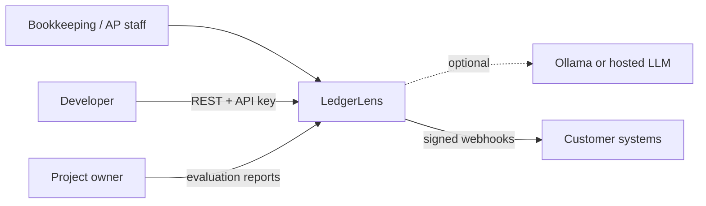
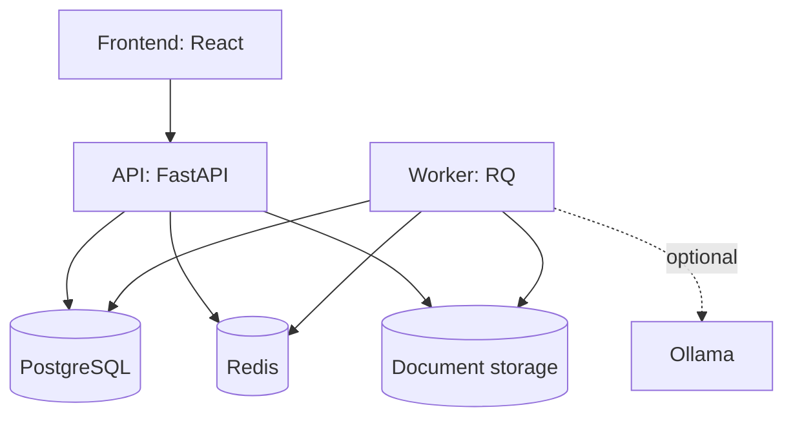
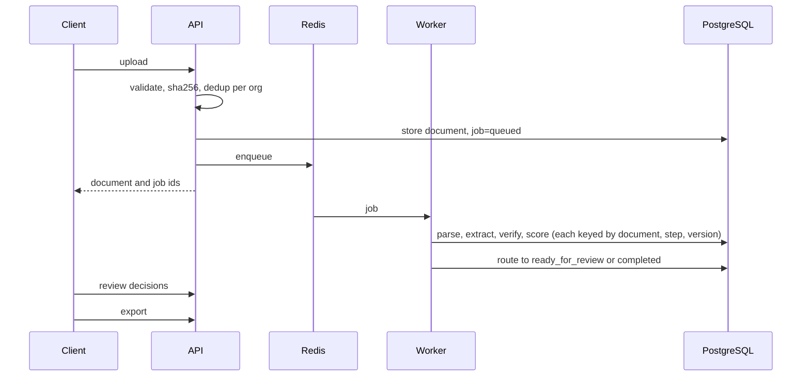
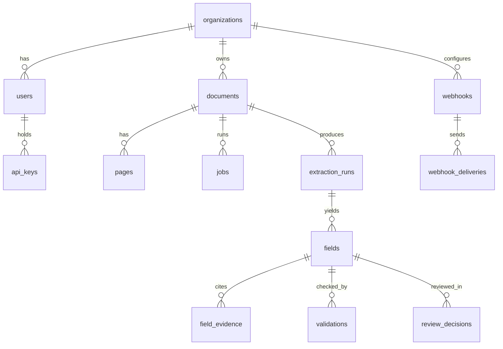
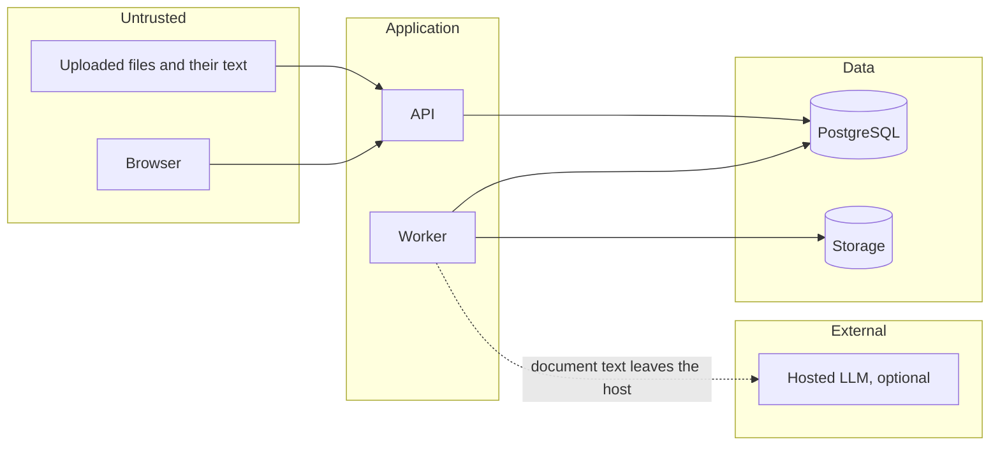

# Architecture

Diagrams describe the intended design. Implementation status is tracked in [progress/TASKS.md](progress/TASKS.md).

## System context

## Containers

## Pipeline

## Data model

## Trust boundaries

Document text is treated as data, never as instructions. The LLM has no tools, and its output is schema-validated and checked against source evidence.
