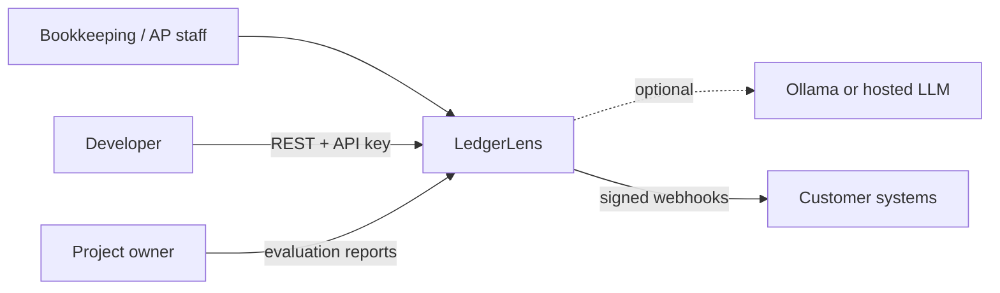
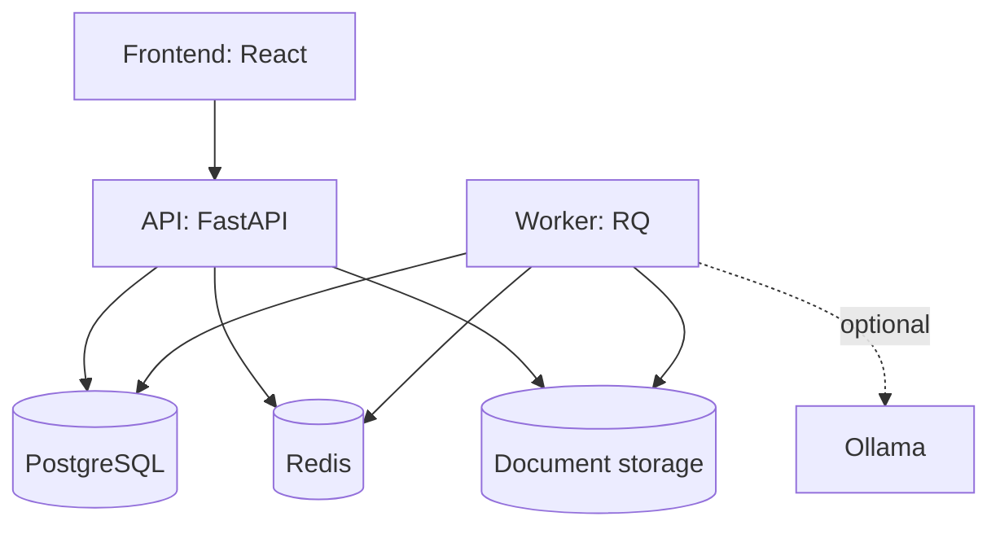
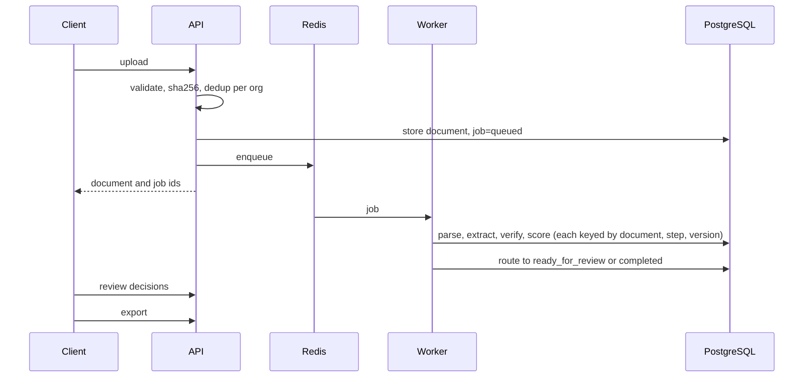
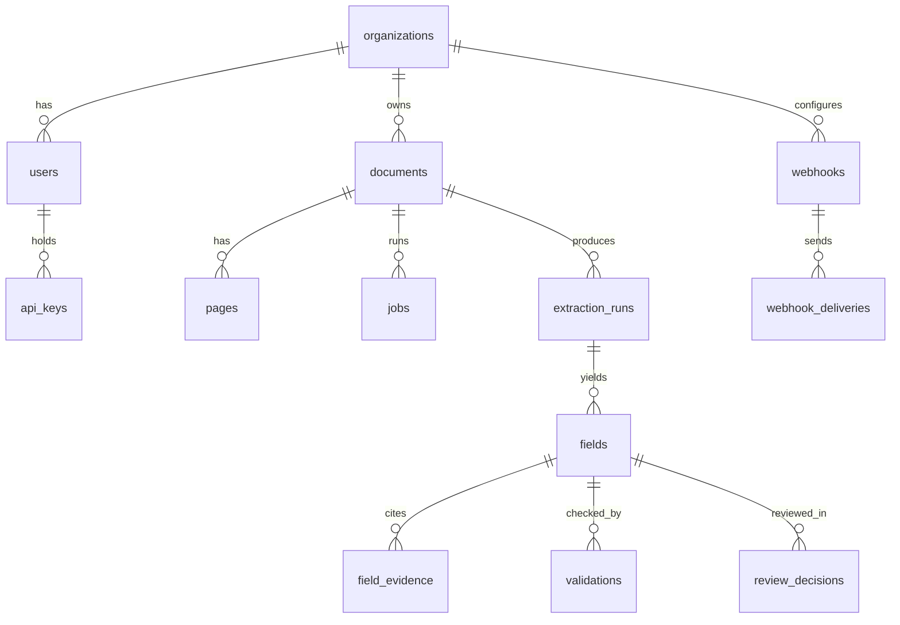
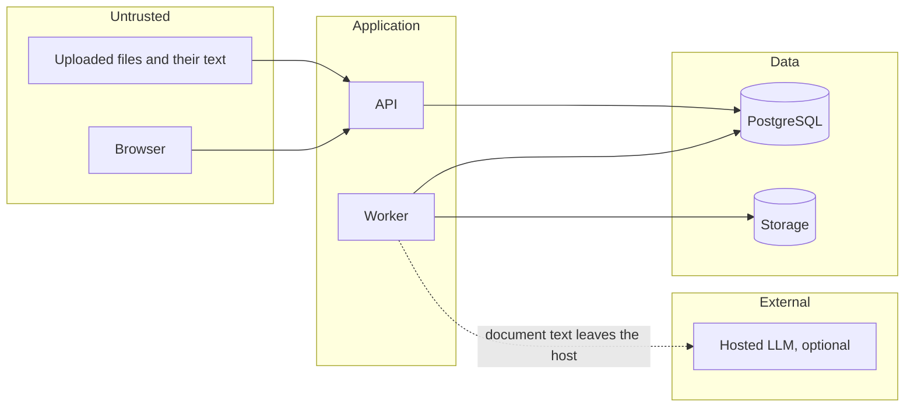

# Architecture

Diagrams describe the intended design. Implementation status is tracked in [progress/TASKS.md](progress/TASKS.md).

## System context

## Containers

## Pipeline

## Data model

## Trust boundaries

Document text is treated as data, never as instructions. The LLM has no tools, and its output is schema-validated and checked against source evidence.

## Worker (Phase 4)

`python -m ledgerlens.workers.run` starts one RQ `SimpleWorker`: one job at a time, in-process, so OCR and the LLM client stay loaded and memory stays bounded. RQ picks a timer-based job timeout where `SIGALRM` is missing (Windows). The Compose service is added with the Dockerfile in Phase 9.

- **States:** queued, parsing, extracting, verifying, scoring, then ready_for_review (any field needs review) or completed, or failed.
- **Claiming:** the worker holds a PostgreSQL advisory lock on the job while it runs. A dead worker's connection closes and frees the lock, so recovery, run at worker start, requeues jobs that are in progress but unlocked. After `len(job_retry_intervals) + 1` attempts, an abandoned job is failed and dead-lettered.
- **Idempotent steps:** parse (pages and tokens) and extract (fields, evidence, validations) are each one transaction with a unique `(document, step, version)` run row. A retry reuses a finished step and redoes an unfinished one.
- **Retries:** RQ `Retry` with backoff `job_retry_intervals` (default 10, 60, 300 s) for transient errors (model server unavailable, database or Redis errors). Permanent errors (stored file missing, unusable model output) fail at once.
- **Dead-letter:** a failed job keeps `error_code`, `error_detail` and `dead_lettered_at` in PostgreSQL, and exhausted RQ jobs stay in RQ's failed registry for 30 days. `GET /jobs/{id}` shows all three.
- **Model unavailable:** `extraction_mode=llm` fails the job with `llm_unavailable`. `extraction_mode=llm_or_rules` stores a run with provider `deterministic`, version `rules-fallback:...`, field source `deterministic_fallback` and a `degraded_reason`, and the job's `error_detail` starts with `degraded:`. A rules result is never labelled as a model result. The default, `rules`, needs no model.
- **Duplicates:** a duplicate upload returns the existing document and job. A job is queued again only if RQ no longer holds it and its state is `queued`.
